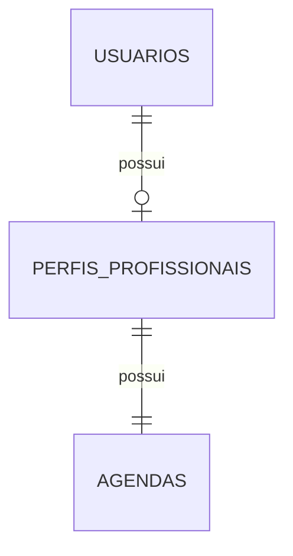

# Banco de dados da primeira entrega

PostgreSQL 17.10. Migrações Flyway imutáveis; Hibernate apenas valida o esquema (`ddl-auto=validate`).

| Tabela | Dados | Restrições principais |
|---|---|---|
| `usuarios` | UUID, nome, e-mail normalizado, hash BCrypt | PK UUID, e-mail obrigatório e único |
| `perfis_profissionais` | UUID, titular, nome, descrição, aceita novos serviços, publicado | FK para usuário, titular único, nome de 2–120 e descrição de 10–3000 caracteres |
| `agendas` | UUID, perfil profissional, fuso de referência | FK para perfil, perfil único, fuso obrigatório |

`V1__criar_tabela_usuarios.sql` cria as contas. `V2__criar_perfis_e_agendas.sql` acrescenta perfil e agenda sem apagar dados anteriores. A agenda inicial usa `America/Sao_Paulo` e não possui horários ou compromissos nesta entrega.

O perfil nasce oculto (`publicado=false`) e, por padrão, aceita novos serviços. A mesma conta pode contratar futuramente e possuir um perfil profissional; não existe escolha exclusiva de tipo de usuário.

A criação bloqueia a linha da conta durante a transação, verifica se existe perfil e grava perfil e agenda juntos. As restrições únicas do banco reforçam a regra. Alterações da conta e do perfil também usam bloqueio da própria conta para serializar mudanças simultâneas.

O volume nomeado `postgres_data` é montado em `/var/lib/postgresql/data`. `docker compose stop`, `start` e `restart` preservam esse volume. Evite `docker compose down -v`, pois remove os dados.

As respostas usam DTOs; entidades JPA e hashes de senha não são serializados diretamente.
